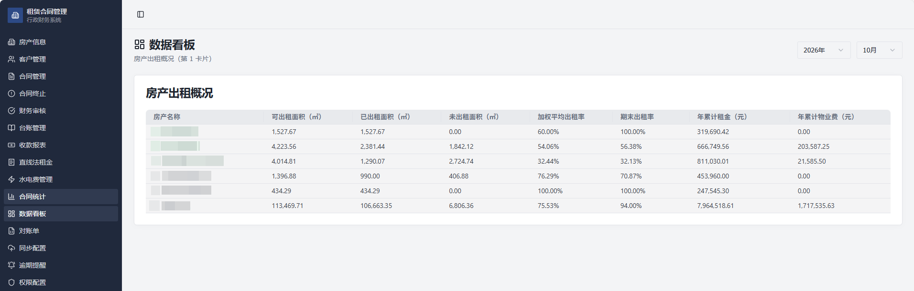
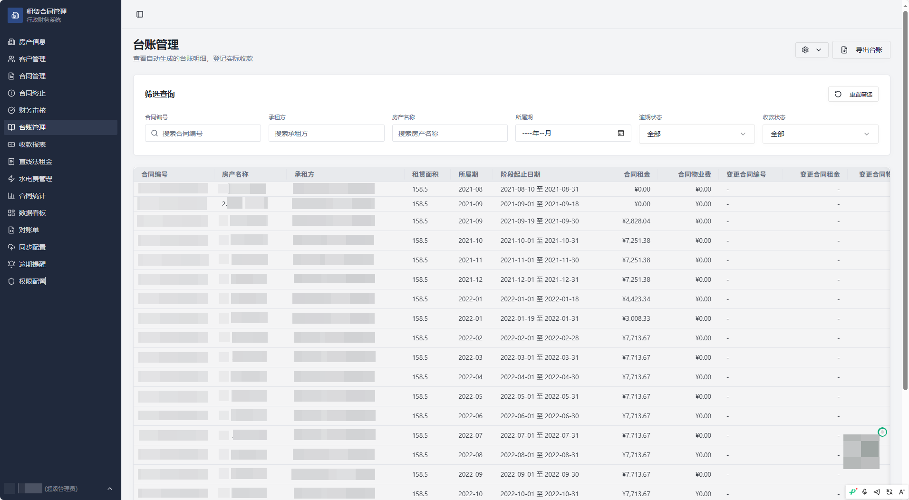
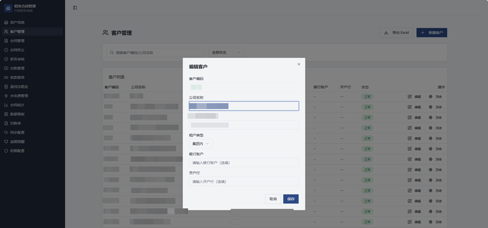
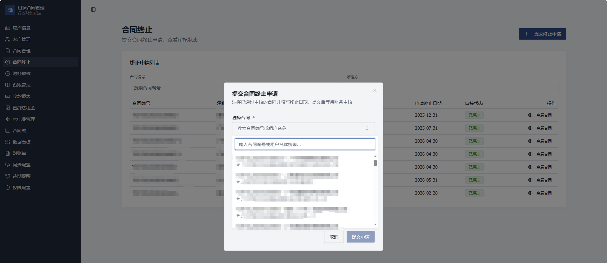
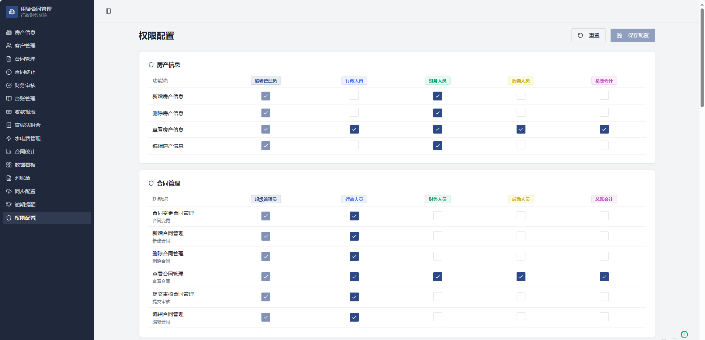
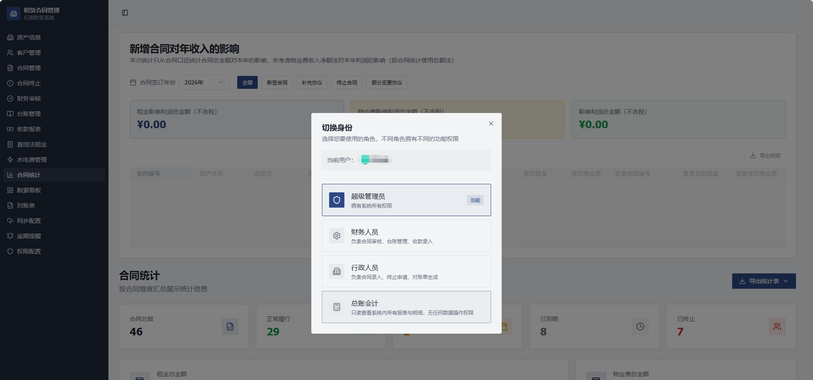
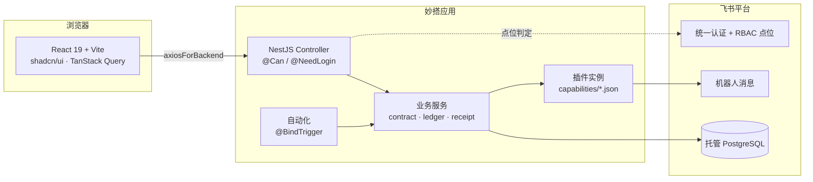

# 行政租赁合同管理系统

[](LICENSE)
[](package.json)
[](#贡献)

基于飞书妙搭（Spark）的租赁合同全生命周期管理系统：房产与客户建档 → 合同录入与分段 → 财务审核 → 台账生成 → 收款登记 → 变更 / 终止，并附带水电费、对账单、逾期提醒与权限配置。

> **运行前提**：这是一个面向飞书妙搭平台的参考实现。数据库、统一认证、RBAC 点位、插件与自动化触发器均由平台提供，脱离妙搭应用无法独立部署。

- **适合**：想落地上线一套「合同 → 台账 → 收款」闭环、复用它作为起点的团队；想研究妙搭全栈应用（NestJS + React + 平台托管 PostgreSQL）写法的开发者。
- **不适合**：需要开箱即用的 SaaS，或需要脱离飞书妙搭独立部署的场景。

## 目录

- [功能](#功能)
- [界面预览](#界面预览)
- [技术栈](#技术栈)
- [架构](#架构)
- [目录结构](#目录结构)
- [快速开始](#快速开始)
- [角色与权限](#角色与权限)
- [关键业务口径](#关键业务口径)
- [测试与检查](#测试与检查)
- [文档](#文档)
- [常见问题](#常见问题)
- [数据与隐私](#数据与隐私)
- [已知限制](#已知限制)
- [贡献](#贡献)
- [第三方组件](#第三方组件)
- [License](#license)

## 功能

- **房产与公司主体**：房产档案、可租面积、所属公司主体与开票税率
- **客户管理**：客户编码、信用代码、银行账户、冻结 / 解冻
- **合同管理**：多阶段租期、变更（补充协议）、终止申请、状态流转
- **财务审核**：合同 / 变更 / 终止三类审核，通过后自动生成或更新台账
- **台账与收款**：按自然月拆分，收款流水驱动回写，支持部分收款与免租期
- **水电费**：后勤登记用量与单价，财务登记收款
- **对账单**：按租户汇总历史未收款，导出 PDF
- **逾期提醒**：租金物业费、水电费、水电费未登记三类，可配置跟进人
- **统计与看板**：合同汇总、金额统计、到期提醒
- **权限**：`action × subject` 点位 + 角色映射，前后端一致校验

## 界面预览

数据看板：



台账管理：



客户管理：



合同终止：



权限配置：



身份切换：



> 截图取自实际运行环境，部分字段已做脱敏处理。侧边栏中的「直线法租金」「同步配置」属内部客制化功能，未包含在本仓库代码中。

## 技术栈

| 层 | 技术 |
|---|---|
| 后端 | NestJS 10、Drizzle ORM、PostgreSQL（平台托管）、class-validator |
| 前端 | React 19、Vite、TypeScript、TanStack Query、Zustand |
| UI | shadcn/ui、Tailwind CSS v4、lucide-react、antd-table toolkit |
| 图表 / 导出 | echarts、xlsx、jspdf + html2canvas |
| 测试 | Jest（56 个单元测试） |

## 架构



## 目录结构

```
server/
  modules/          业务模块：contract / ledger / receipt / termination /
                    utility / property / customer / overdue / dashboard /
                    permission
  database/         schema.ts（平台生成，勿手改）
  capabilities/     妙搭插件实例配置
client/src/
  pages/            16 个页面目录
  components/       shadcn/ui 与业务组件（PermissionGate 等）
  config/           组织名称等可配置项
shared/             前后端共享类型
data/               建表、权限点位、演示数据脚本
docs/               数据库、接口、功能、视觉与组件规范
test/               单元测试
```

## 快速开始

### 前置条件

- Node.js 22+、npm 10+
- 一个飞书妙搭应用（用于托管数据库、认证与平台能力）
- `lark-cli`（通过 `npx` 调用，无需全局安装），并按提示完成 `lark-cli auth login`

### 启动

```bash
git clone https://github.com/NIko-oo/lease-contract-management.git
cd lease-contract-management
npm install

# 同步平台脚本，并生成含你 app_id 的 .spark/meta.json（该文件不入库）
npx -y @lark-apaas/miaoda-cli@latest app sync

npm run dev
```

`.spark/meta.json` 由平台生成，包含环境专属 `app_id`，已在 `.gitignore` 中排除。若没有该文件，先确认妙搭应用已创建并与本地目录关联。

### 初始化数据库

按以下顺序在 **dev** 环境执行（`<YOUR_APP_ID>` 替换为你的应用 ID）：

```bash
# 1. 表结构（仅 dev；线上用 +db-env-migrate 同步）
lark-cli apps +db-execute --app-id <YOUR_APP_ID> --environment dev --file ./data/receive_reports_table.sql --yes

# 2. 权限点位（dev / online 各一次）
lark-cli apps +db-execute --app-id <YOUR_APP_ID> --environment dev --file ./data/authz_read_permissions.sql --yes
lark-cli apps +db-execute --app-id <YOUR_APP_ID> --environment dev --file ./data/authz_receipt_permissions.sql --yes
lark-cli apps +db-execute --app-id <YOUR_APP_ID> --environment dev --file ./data/authz_gl_accountant_role.sql --yes

# 3. 演示数据（全部虚构，可重复执行）
lark-cli apps +db-execute --app-id <YOUR_APP_ID> --environment dev --file ./data/seed/demo_data.sql --yes
lark-cli apps +db-execute --app-id <YOUR_APP_ID> --environment dev --file ./data/overdue_configs.sql --yes
```

线上环境禁止执行 DDL / DCL，表结构通过 `+db-env-migrate` 从 dev 同步。脚本细则见 [`data/README.md`](data/README.md)。

### 环境变量

复制 `.env.example` 为 `.env`。使用平台托管数据库时 `SUDA_DATABASE_URL` 留空，由平台注入。`.env` 与 `.env.local` 均已被忽略。

## 角色与权限

| 角色 key | 名称 | 典型职责 |
|---|---|---|
| `super_admin` | 超级管理员 | 全部点位，含权限配置 |
| `finance` | 财务人员 | 合同 / 变更 / 终止审核、台账收款、收款报表、统计、逾期提醒 |
| `administrative` | 行政人员 | 房产、客户、合同录入与变更、终止申请、对账单 |
| `logistics` | 后勤人员 | 水电费登记 |
| `role_99xxcvu983p` | 总账会计 | 全部 `read` 点位，纯只读（平台生成的角色标识，创建后不可改） |

前端按角色优先级 `super_admin > finance > administrative > logistics > role_99xxcvu983p` 默认选中；权限仍是**按点位**校验，UI 受控一律用 `CanPoint` / `usePointPermission`，不要用平台 `<Can>`（平台点位不受本系统权限配置页影响）。

## 关键业务口径

- **合同状态机**：`draft → pending → approved / rejected`，`approved → terminated`
- **应收金额**：`COALESCE(amendment_rent, monthly_rent)`，是 `??` 语义——变更为 0 时应收就是 0，不能回退到原合同金额
- **收款事实**：只以 `receive_records` 为准；`ledger_items.rent_received` 是期级已收按行 FIFO 分摊后的汇总
- **免租期**：应收双 0 的期间置 `no_payment_required`，不进逾期与对账单

更完整的跨表不变式见 [`AGENTS.md`](AGENTS.md)。

## 测试与检查

```bash
npm test            # 56 个单元测试
npm run type:check  # server + client 类型检查
npm run build:prod  # 生产构建（跨平台，不依赖妙搭 CLI）
node scripts/gate.js  # 提交门禁（eslint / type check / stylelint / jest）
```

> `npm run build` 是妙搭沙箱内的构建入口，依赖平台提供的 `fullstack-cli`；本地与 CI 请用 `npm run build:prod`。

## 文档

| 文档 | 内容 |
|---|---|
| [`AGENTS.md`](AGENTS.md) | 平台约定与坑、开发流程、跨表不变式——改代码前必读 |
| [`docs/features.md`](docs/features.md) | 每个页面的字段、筛选项、弹窗交互与导出规则 |
| [`docs/database.md`](docs/database.md) | 表结构逐字段说明、ER 图、迁移与初始化 |
| [`docs/api-routes.md`](docs/api-routes.md) | 接口清单与所需权限点位对照 |
| [`docs/ui-design.md`](docs/ui-design.md) | 色彩、字体、布局骨架与视觉禁区 |
| [`docs/ui-components.md`](docs/ui-components.md) | shadcn 组件用法与图标规范 |
| [`data/README.md`](data/README.md) | 各 SQL 脚本的作用、幂等性与可执行环境 |

## 常见问题

**启动提示找不到 `.spark/meta.json`**

先执行 `npx -y @lark-apaas/miaoda-cli@latest app sync`，把本地目录与妙搭应用关联；该文件含环境专属 `app_id`，不入库。

**手改了 `server/database/schema.ts`，结果被覆盖**

它是 `fullstack-cli gen-db-schema` 的生成物。改表要走数据库侧（`data/<表>.sql`），再重新生成，不要直接编辑该文件。

**发布后线上没有变化**

发布默认只进 dev 环境，线上需要再显式发布一次。

**按钮能看到，点了却提示无权限**

前端 `CanPoint` 的 `action` / `subject` 必须与后端 controller 上 `@Can` 的字面完全一致；另外平台 `<Can>` 读的是平台侧点位，不受本项目权限配置页影响。

**权限配置页改了没生效**

`authz_*` 在 dev 与 online 是两套独立的库，改了哪个环境只有那个环境生效。

**线上执行建表脚本报 `forbid ddl/dcl operation`**

线上禁止 DDL / DCL，表结构用 `+db-env-migrate` 从 dev 同步，线上只跑 DML。

## 数据与隐私

本仓库不包含任何生产数据。`data/seed/demo_data.sql` 中的公司、客户、信用代码、银行账号与合同均为虚构。部署到自己的环境后，请将 `client/src/config/organization.ts` 中的组织名称改为实际主体。

发现安全问题请按 [`SECURITY.md`](SECURITY.md) 私下报告，不要开公开 Issue。

## 已知限制

- 依赖飞书妙搭平台：数据库句柄、认证、RBAC 与插件/自动化触发器均由平台注入，无法脱离平台运行
- `AGENTS.md` 中部分指针指向本项目内部的私有知识库，未随仓库发布

## 贡献

欢迎 Issue 与 Pull Request：

1. 提 Issue 时请说明复现步骤、期望行为与实际结果；涉及界面问题请附截图
2. 提交前跑一遍 `node scripts/gate.js`（eslint / 类型检查 / stylelint / jest 全过才放行）
3. 改动命中合同、台账、金额计算或状态流转路径时，请同时补充或修改对应的 `test/unit/*.spec.ts`
4. 安全漏洞不要走私密报告以外的渠道，见 [`SECURITY.md`](SECURITY.md)

## 第三方组件

`@lark-apaas/*` 系列 SDK 与飞书妙搭生成的模板代码版权归飞书所有，其使用受平台条款约束。本仓库的 MIT 许可仅覆盖本项目自有代码。

## License

[MIT](LICENSE)

---

🛰 联系方式：854548218
